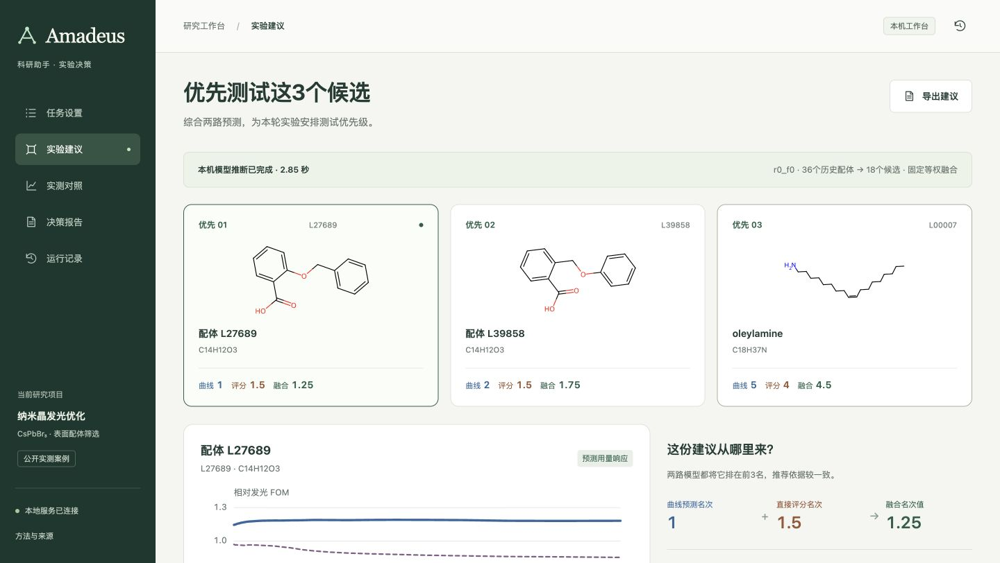
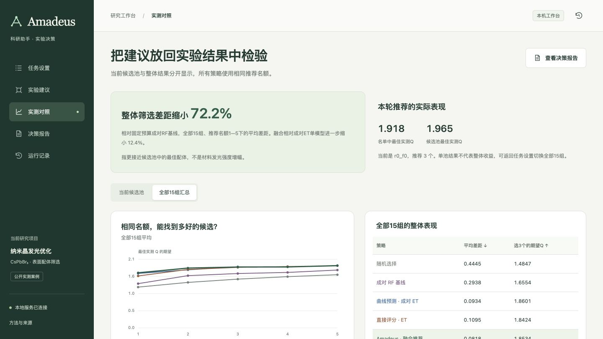

# Amadeus · 科研助手

从已有实验和模型预测出发，比较候选，形成下一轮实验建议。

Amadeus提供完整的本机工作台：**设置任务 → 实际计算 → 查看推荐 → 实测对照 → 导出报告**。材料研发是首个落地领域，CsPbBr₃纳米晶配体筛选是基于公开实测数据的首个案例。

**[打开在线演示](https://nighty35628.github.io/ligand-screening/)** · [四分钟讲解流程](docs/DEMO.md) · [原计算流程与基线](PIPELINE.md) · [资源归属](THIRD_PARTY.md)



## 在本机启动

需要 `uv` 或 Python 3.12。首次启动安装锁定依赖；依赖就绪后无需网络、API Key或平台账号。

```bash
git clone https://github.com/nighty35628/ligand-screening.git
cd ligand-screening
./run_amadeus.sh
```

打开 **http://127.0.0.1:8787**。端口占用可用 `./run_amadeus.sh --port 8788`。

使用现成Python环境：

```bash
AMADEUS_PYTHON=/absolute/path/to/python ./run_amadeus.sh
```

### 两种运行方式

| 方式 | 实际执行 | 可用范围 |
|---|---|---|
| 本机模型推断 | 加载已训练权重，计算响应曲线、直接评分及融合排名 | 仓库自带候选组01的模型 |
| 快速回放 | 读取已核验的预测，重新计算排名与固定融合 | 全部15组；本机和在线演示均可用 |

此次产品升级没有训练、调参或新增机制。主方法保持成对ET、直接评分ET、等权排名融合。默认36种历史配体、18个候选，可选择1—5个推荐名额。两路并列使用固定seed 42。说明由真实结果驱动的模板生成，不调用外部大模型。

已有其他池权重可通过 `AMADEUS_MODEL_DIR=/path/to/models` 接入；仅加载自己信任、符合本仓库模型协议的文件。首版使用预计算分子特征，不支持任意SMILES自动预测。

## 可以做什么

- 设置测试名额，查看候选结构和数据范围。
- 真正调用已保存模型，或快速回放历史预测。
- 查看推荐候选、两路排名、用量响应曲线与分歧说明。
- 揭晓历史实测结果，切换本池对照和全部15组汇总。
- 下载候选CSV、运行JSON；打开含曲线的报告，打印或保存PDF。
- 返回运行记录，重新查看和导出。记录保存在 `outputs/amadeus/`，不上传GitHub。

本机服务只监听回环地址。推荐接口不返回候选实测标签，点击揭晓后才请求答案。GitHub Pages是独立的静态回放，包含公开档案答案，不用于盲测或新输入的模型推断。



## 当前案例效果

90种完整配体，每种40个用量点；15个固定候选池。Q为40点中最高4点相对发光FOM的均值。平均筛选差距AUR为推荐名额1—5下，与候选池最佳Q的平均距离，越低越好。

| 方法 | 平均筛选差距 ↓ | 推荐3个后的期望最佳Q ↑ |
|---|---:|---:|
| 随机选择 | 0.444518 | 1.484686 |
| 成对RF基线 | 0.293812 | 1.655376 |
| 成对ET | 0.093398 | 1.860129 |
| 直接评分ET | 0.109520 | 1.842430 |
| 等权融合 | **0.081803** | 1.853399 |

完整方案相对固定预算RF的平均筛选差距下降约 **72.2%**，其中融合相对成对ET下降约 **12.4%**。前者包含分子表示和模型变化。融合在推荐3个时比成对ET略低约0.36%，并非每个预算或候选池都胜出。

这些是公开数据的回顾性结果，不是发光增强百分比、真实实验成本节省或新增湿实验。全部结果与原有基线保留，参见 [统一报告](results/reference/REPORT.md) 和 [原计算流程](PIPELINE.md)。

## 目录

```text
amadeus/server.py       本机服务、保存模型推断、运行记录、报告
amadeus/web/            响应式工作台及静态回放
amadeus/assets/         首池已训练模型及SHA256清单
allis_delivery/        已有固定模型和排名函数（原计算内核保留）
allis_benchmark/        已有统一基线比较
docs/                  演示讲解、截图、运行验收记录
demo/final/            保留的早期演示
```

SciencePal接入暂不在当前产品范围。跨材料或跨领域任务需要适配特征、模型和验证；当前完整案例为CsPbBr₃配体筛选。
