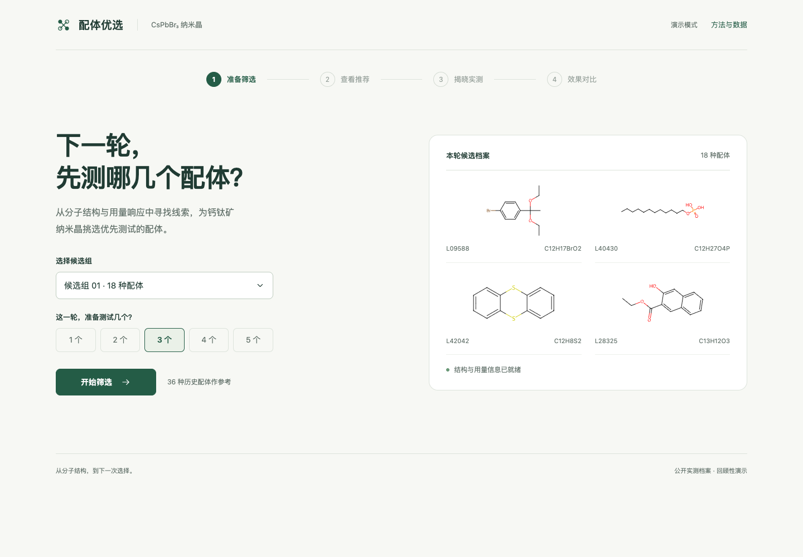

# 配体优选 · Ligand Screening

基于公开 CsPbBr₃ 钙钛矿纳米晶配体数据，用两路模型生成候选推荐：成对 ET 预测用量响应曲线，直接评分 ET 预测配体质量，两者按固定等权排名融合。

本仓库包含可运行代码、冻结输入与预测、统一基线比较、测试及离线可视化演示。无需实验设备即可复核历史数据上的筛选效果。

**[直接打开在线演示](https://nighty35628.github.io/ligand-screening/)** — 无需登录、下载代码或安装环境。

## 快速开始

需要 Python 3.12 或 uv。首次运行会创建环境并安装锁定依赖；已有环境可用 `ALLIS_PYTHON=/path/to/python` 指定。

```bash
git clone https://github.com/nighty35628/ligand-screening.git
cd ligand-screening
./run_project.sh
```

默认复算15个固定候选池、六种策略，新增拟合0次。输出到新的 `outputs/project-.../`，包含报告、逐池结果、预测和独立核验记录。默认缓存回放与实际训练分别标记。

## 看演示

组员与评委可直接访问 **https://nighty35628.github.io/ligand-screening/**。在线版与下方本地版使用相同的冻结数据和页面，支持手机和电脑浏览。

```bash
./run_demo.sh
```

打开终端打印的本地地址。也可以直接用浏览器打开 [demo/final/index.html](demo/final/index.html)。页面可离线运行，按“设置 → 推荐 → 揭晓实测 → 效果对比”逐步展开。首页不显示结果；短进度动画可以跳过或取消。候选结构、两路预测与曲线在推荐阶段出现，完整方法说明按需展开。



页面展示已生成的固定结果，不在浏览器现场训练；真正训练和预测使用命令行入口。

`main` 分支的 `demo/final/` 更新后会自动发布到 GitHub Pages。发布前自动核对页面与数据的 SHA256；也可在 Actions 中手动运行 `Deploy demo to GitHub Pages`。

## 统一结果

90种完整配体，每种40个用量点；三套五折共15池，每池36种历史配体、18种候选。Q为40点中最高4点相对发光FOM的均值。AUR是推荐预算1—5下与池内最优Q的平均差距，越低越好。

| 方法 | AUR ↓ | 推荐3个后的最佳Q ↑ |
|---|---:|---:|
| 随机选择 | 0.444518 | 1.484686 |
| 成对RF：均值排序 | 0.293812 | 1.655376 |
| 成对RF：上界排序 | 0.293812 | 1.655376 |
| 成对ET | 0.093398 | 1.860129 |
| 直接评分ET | 0.109520 | 1.842430 |
| **等权融合** | **0.081803** | **1.853399** |

融合相对固定预算成对RF的平均筛选差距降低约72.2%，相对成对ET降低约12.4%。预算3时相对成对ET略低0.36%。百分比描述筛选差距，不能理解为材料发光增幅。

RF使用42维结构描述符；ET使用42维描述符加Morgan指纹，因此相对RF的差异包含表示、估计器和决策变化。融合自身的贡献应通过两个ET单模型比较判断。RF是固定计算预算移植，不是完整逐轮主动学习复现。

[完整结果摘要](results/reference/REPORT.md) · [逐池CSV](results/reference/per_pool.csv) · [机器可读指标](results/reference/metrics.json)

## 训练与预测

重训全部RF基线，ET预测复用已验证的历史结果：

```bash
./run_project.sh run --mode baseline-retrain --output outputs/rf_reproduction
./run_project.sh verify --run-dir outputs/rf_reproduction
```

这会训练并保存15个RF模型，运行上限20次拟合／20分钟，无寻参。输出目录须为空或不存在。

训练两个ET组件并生成融合结果：

```bash
# 单池工程检查，2次拟合
./run_project.sh models run --mode retrain --splits r0_f0 --output outputs/component_check

# 全部15池，30次拟合；与上述RF重训分别计数
./run_project.sh models run --mode retrain --output outputs/component_full
```

利用保存的组件权重预测无标签输入：

```bash
./run_project.sh models predict --run-dir outputs/component_check --split r0_f0 \
  --candidates outputs/component_check/candidate_inputs/r0_f0.npz \
  --output outputs/prediction.json
```

候选输入格式及RF预测命令见 [运行说明](allis_benchmark/README.md)。当前支持预计算结构特征，尚不支持任意SMILES自动生成全部42维特征。

## 测试

```bash
.venv-allis/bin/python -m unittest discover -s tests -v
```

覆盖无标签预测、参考差值重建、固定融合、平局精确期望、预算限制、独立目录运行、篡改检测和覆盖保护。浏览器验收记录见 `demo/final/qa/`；浏览器测试脚本需要本机Chrome和Playwright，运行应用本身不需要。

## 目录

- `allis_delivery/`：两个ET模型的训练、保存加载、预测、融合和评估。
- `allis_benchmark/`：RF与随机基线、统一协议、完整对比和独立复算。
- `demo/`：原演示、最新六策略演示及导出脚本。
- `tests/`：核心和可移植性测试。
- `results/reference/`：已完成运行的轻量结果快照；重新运行生成完整可核验目录。

大体积训练权重、本地虚拟环境、历史研究、提交草稿和临时文件未纳入仓库。权重可按固定配置重训。资产中的历史项目路径用于溯源，不是运行依赖。

## 证据与资源

全部效果来自公开档案的回顾性评估。这些数据曾用于前期方法探索，本次重训验证工程可复现性，不形成新的独立盲测。不同池包含重复身份，不按15个独立实验解释；没有新增湿实验或已证实的真实实验成本节省。

数据和借鉴方法来源见 [THIRD_PARTY.md](THIRD_PARTY.md)；文件级来源与哈希见 `allis_delivery/assets/provenance.json`、`allis_benchmark/assets/protocol.json`。本仓库没有为第三方资源授予新的许可。
