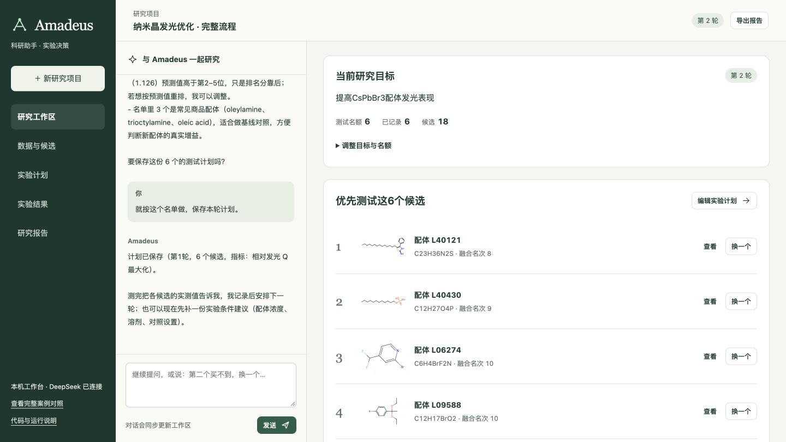

# Amadeus · 科研助手

把研究问题、数据分析和下一轮实验安排放在同一个工作区。

**[在线案例展示](https://nighty35628.github.io/ligand-screening/)** · [四分钟演示](docs/DEMO.md) · [验收记录](docs/DELIVERY.md) · [原计算流程](PIPELINE.md) · [资源归属](THIRD_PARTY.md)



## 本机启动

需要 uv 或 Python 3.12。首次运行安装锁定依赖。

```bash
git clone https://github.com/nighty35628/ligand-screening.git
cd ligand-screening
cp .env.example .env.local
# 在 .env.local 填写 DeepSeek API Key
./run_amadeus.sh
```

打开 http://127.0.0.1:8787 。现成环境可用 `AMADEUS_PYTHON=/absolute/path/to/python ./run_amadeus.sh`；换端口使用 `--port 8788`。

对话、联网检索和网页读取使用 DeepSeek。固定模型推断、CSV 建模、计划编辑和报告导出在本机运行。密钥放在被 Git 忽略的 `.env.local`，不会传给浏览器。

## 三种起点，同一份研究记录

- **有明确问题**：直接输入目标，助手检索资料，生成带出处、测试条件和观察指标的行动卡，编辑后保存为实验计划。
- **有自己的数据**：上传历史表和候选表，选择目标、特征、分组及优化方向。自动比较 ET、线性模型、梯度提升树和简单参照，输出候选排序。支持数值回归与二分类；二分类按目标类别概率排序。
- **想先体验完整案例**：载入 CsPbBr₃ 纳米晶配体筛选，实际调用已保存的成对 ET、直接评分 ET 和等权排名融合，查看结构、用量响应和两路排名。

对话会实际修改工作区。例如“第二个买不到，换一个”“这一轮测试6个”“就按这个名单保存”。候选编号保持不变，名额和排除条件只调整名单；科学模型的原始预测保持不变。

保存计划后，可以手动回填、导入结果 CSV，或在公开案例中揭晓历史实测。下一轮排除已完成候选；CSV 工作流还可把累积的新观测纳入重新建模。计划按轮次保存版本，结果保留记录，报告与实验表可导出。项目存储在本机 `outputs/amadeus-workspace/`。

## 展示与运行

| 入口 | 内容 |
|---|---|
| 本机工作台 `/` | 对话、检索、CSV 建模、实验计划、结果、下一轮、报告 |
| 完整案例 `/classic.html` | 原固定模型推断、15个候选池回放及基线对照 |
| GitHub Pages | 首页与完整案例静态回放；通用工作台通过本机服务运行 |

固定案例自带第一池权重，36种历史配体、18种候选。通用表格示例使用另一个公开纳米晶配方数据子集：80条历史记录与12条候选，按原分组拆分，用于展示数据工作流。来源见 THIRD_PARTY.md。

当前升级扩展的是工作流程。CsPbBr₃ 的原模型、特征、融合规则和历史评估结果保持不变。

## 当前案例效果

90种完整配体，每种40个用量点；15个固定候选池。Q为40点中最高4点相对发光FOM的均值。平均筛选差距AUR为推荐名额1—5下，与候选池最佳Q的平均距离，越低越好。

| 方法 | 平均筛选差距 ↓ | 推荐3个后的期望最佳Q ↑ |
|---|---:|---:|
| 随机选择 | 0.444518 | 1.484686 |
| 成对RF基线 | 0.293812 | 1.655376 |
| 成对ET | 0.093398 | 1.860129 |
| 直接评分ET | 0.109520 | 1.842430 |
| 等权融合 | **0.081803** | 1.853399 |

完整方案相对固定预算RF的平均筛选差距下降约 **72.2%**，其中融合相对成对ET下降约 **12.4%**。前者包含分子表示和模型变化。融合在推荐3个时比成对ET略低约0.36%，并非每个预算或候选池都胜出。

这些是公开数据的回顾性结果，不是发光增强百分比、真实实验成本节省或新增湿实验。全部结果与原有基线保留，参见 [统一报告](results/reference/REPORT.md) 和 [原计算流程](PIPELINE.md)。

## 代码入口

- `amadeus/server.py`：本机 HTTP 服务与固定案例推断。
- `amadeus/workflow.py`：项目状态、对话工具、计划、结果与导出。
- `amadeus/provider.py`：DeepSeek 对话、Search 和 Fetch。
- `amadeus/tabular.py`：通用表格模型比较与预测。
- `amadeus/web/`：主工作台及保留的案例回放。
- `amadeus/assets/`：固定案例权重及校验清单。

服务监听本机回环地址。关闭后再启动，项目与已保存计划会恢复。
