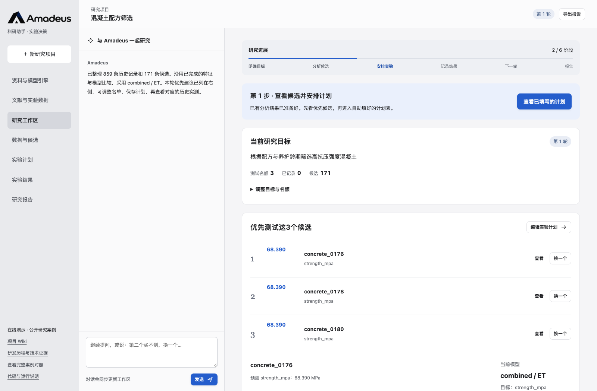
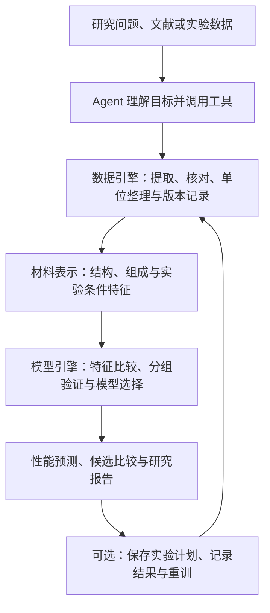

<p align="center">
  <picture>
    <source media="(prefers-color-scheme: dark)" srcset="docs/branding/amadeus-logo-dark.svg">
    
  </picture>
</p>

<p align="center">材料研究的数据分析与建模助手</p>
<p align="center">求索漫漫，顺理千绪，共见天光。<br>To seek. To find. Together.</p>

<p align="center">
  <a href="https://nighty35628.github.io/ligand-screening/">在线体验</a> ·
  <a href="https://nighty35628.github.io/ligand-screening/wiki/">项目 Wiki</a> ·
  <a href="https://github.com/nighty35628/ligand-screening/releases/latest">下载 Release</a> ·
  <a href="https://nighty35628.github.io/ligand-screening/evidence.html">研发与运行证据</a>
</p>

## Amadeus 能做什么

材料研究中，一份历史实验表往往要经过字段整理、单位换算、特征构造和模型比较，才能用于预测新候选。资料、分析脚本和实验记录分散后，研究者还得反复核对：模型用了哪些数据，这个结果对应什么条件，为什么优先考虑这几个候选。

Amadeus 把这些工作放进同一个研究项目。你可以从问题出发查找资料，也可以直接上传历史数据和候选表，指定要预测的性能。系统整理输入、比较特征与模型，输出预测、候选排名、模型误差和图文报告。需要继续实验时，可以保存计划、记录结果，再把新观测纳入下一轮分析。



## 先体验，再接入自己的数据

[打开在线工作台](https://nighty35628.github.io/ligand-screening/)，点击“选择这个研究”。纳米晶案例自动演示完整流程；其余四个案例会预填内容，并提示每一步的操作。无需注册或配置 API Key。

在线版与本机版共用界面，使用真实计算后保存的预测和公开参考结果，项目记录保存在当前浏览器中。本机版接通自定义数据处理、模型训练和 DeepSeek 对话、搜索与网页读取。

| 你手头有什么 | 从哪里开始 | 可以得到什么 |
|---|---|---|
| 一个研究问题 | 输入目标，检索和阅读资料 | 带来源的分析、研究条件与行动建议 |
| 历史数据和待评估候选 | 上传表格，指定目标、特征和分组 | 模型比较、验证误差、候选预测与排名 |
| 已经完成的实验结果 | 录入或导入结果，关联原计划 | 更新后的记录、下一轮候选与研究报告 |

## 五个已跑通的材料案例

五个案例都经过数据整理、实际建模和结果评估，并已接入工作台。下表中的训练与候选数量、指标沿用各案例各自的固定划分。

| 案例 | 数据规模（训练 / 候选） | 已有结果 | 详细记录 |
|---|---|---|---|
| CsPbBr₃ 纳米晶配体筛选 | 90 种完整配体，每种 40 个用量点；15 个池，每池 36 / 18 种 | 排名融合的平均筛选差距较成对 ET 下降 **12.4%** | [方法与结果](PIPELINE.md) |
| 混凝土抗压强度 | 859 / 171 条 | 留出 MAE **5.20 MPa**；推荐 3 个中的最高实测 79.30 MPa，池内最高 79.99 MPa | [数据与模型验收](docs/ENGINE_UPGRADE_RESULTS.md) |
| 钢合金屈服强度 | 265 / 47 种组成 | 留出 MAE **85.28 MPa**，R² **0.832**；推荐 3 个包含池内最高值 | [钢合金案例](docs/STEELS_CASE.md) |
| 双钙钛矿带隙 | 1,111 / 195 条 | 留出 MAE **0.211 eV**，R² **0.963**；前 3 个推荐均位于候选前 10% | [数据与评估](results/unprepared-20261029/README.md) |
| 材料热导率 | 642 / 120 条 | 推荐 5 个包含池内最高值；留出 MAE **7.71 W/(m·K)**，R² **0.268** | [数据与评估](results/unprepared-20261029/README.md) |

以上为公开数据的回顾性评估。双钙钛矿带隙标签来自 GLLB-SC 计算；热导率排序有用，但绝对值预测仍较弱。各案例的数据来源、分组和误差都保留在链接中，数值不代表新增湿实验或实际节省的实验次数。

<details>
<summary>查看纳米晶筛选的模型对照</summary>

每种配体的表现 Q 定义为 40 个用量点中最高 4 点相对发光 FOM 的均值。平均筛选差距 AUR 衡量推荐名额 1 至 5 下，与池内最佳 Q 的平均距离，越低越好。

| 方法 | 平均筛选差距 AUR ↓ | 推荐 3 个后的期望最佳 Q ↑ |
|---|---:|---:|
| 随机选择 | 0.444518 | 1.484686 |
| 成对 RF 对照 | 0.293812 | 1.655376 |
| 成对 ET | 0.093398 | 1.860129 |
| 直接评分 ET | 0.109520 | 1.842430 |
| 等权排名融合 | **0.081803** | 1.853399 |

完整方案的平均筛选差距较固定预算 RF 对照下降约 72.2%，其中包含分子表示和模型变化。融合相对成对 ET 的下降为 12.4%；在推荐 3 个时，期望最佳 Q 比成对 ET 略低约 0.36%。15 个固定候选池存在重叠，结果按回顾性评估解释。

[统一评估报告](results/reference/REPORT.md) · [计算流程与复算入口](PIPELINE.md)

</details>

## 技术流程



### 数据如何进入模型

支持 CSV、JSON、文本型 PDF 和正文资料。文献提取先生成带原文依据的草稿，检查并接受后才进入实验表。数据引擎记录缺失、重复和单位转换，保存原值与修改历史；反应数据还可区分样品、参照与空白。

材料表示按输入组织：分子结构可生成 RDKit 描述符和 Morgan 指纹；已准备的组成案例使用元素比例与周期表统计特征；温度、龄期等实验条件作为单独字段参与比较。用户也可以直接提供已有的特征列。表格入口支持数值回归和二分类；二分类按目标类别概率排序。

### 聚合建模引擎

通用回归引擎比较 Random Forest、Extra Trees、XGBoost、LightGBM、Ridge 和简单参照。特征组可分别建模，再与组合输入比较；可选的互信息 Top-K 筛选和 Optuna TPE 参数搜索在训练部分内部执行。

已有四个通用材料案例各完成 22 组设置比较：3 类输入 × 6 类默认模型，加 4 类优化模型。开发集采用外层五折验证，优化使用三折内层验证。按配方或组成分组时，同组记录留在同一折；最终候选标签用于评价，不参与模型选择。小预算优化没有胜过默认模型时，保留默认模型。

纳米晶专用流程使用两路 ET：成对 ET 预测用量响应，直接评分 ET 预测配体整体表现，再将两路候选名次等权融合。界面可以查看分子结构、响应曲线、两路排名，以及两个单模型对照。

### Agent 如何组织整个研究

DeepSeek 负责理解请求、搜索资料和选择工具，实际计算由数据与模型工具完成。工具结果写回项目状态，形成可继续编辑的工作区。一次运行保留数据版本、特征列表、验证划分、模型比较与预测，报告可以追溯到这些记录。

对话也可以调整已有项目，例如“第二个买不到，换一个”“这一轮测试 6 个”“就按这个名单保存”。名单调整沿用模型原始预测。计划按轮次保存，回填结果与对应分析关联；项目关闭重开后可继续使用。

[架构说明](https://nighty35628.github.io/ligand-screening/wiki/architecture/) · [模型说明](https://nighty35628.github.io/ligand-screening/wiki/models/) · [数据规范](https://nighty35628.github.io/ligand-screening/wiki/data/)

## SciencePal 在研发中的作用

SciencePal 参与了问题拆解、公开数据核查、验证协议设计和独立方法对照。我们利用其自带研究工作流，将文献、数据审查和代码执行串联，并保存对话及计算产物。团队与 Codex 继续完成材料判断、生产模型评估、工程开发和交付。

其中一次独立研究在 5 个固定候选池上实际比较了直接评分 RF、曲线 RF、Ridge 和随机策略；直接评分 RF 的平均筛选差距最低，独立复算与保存结果一致。这项研究与产品中的 ET 融合评估分别保留。SciencePal 用于方法研发，日常运行使用下方的本机配置。

[SciencePal 研究结果](docs/evidence/sciencepal-results.md) · [数据与验证讨论](https://sciencepal.ai/share/466b0498-6ea0-420d-a24e-82e8070dc534) · [独立方法研究](https://sciencepal.ai/share/66b2fd80-3f93-4550-b06d-5fa4feaf7822)

## 本机运行

需要 uv 或 Python 3.12。首次启动会安装固定版本依赖。

```bash
git clone https://github.com/nighty35628/ligand-screening.git
cd ligand-screening
cp .env.example .env.local
# 在 .env.local 填写 DeepSeek API Key
./run_amadeus.sh
```

打开 http://127.0.0.1:8787 。DeepSeek 用于对话、搜索和网页读取；表格建模、固定模型推断、计划编辑与报告导出在本机执行。密钥保存在被 Git 忽略的 `.env.local`，不会传给浏览器。

现成环境可用 `AMADEUS_PYTHON=/absolute/path/to/python ./run_amadeus.sh`；换端口使用 `--port 8788`。项目数据保存在 `outputs/amadeus-workspace/`。

也可从 [Release](https://github.com/nighty35628/ligand-screening/releases/latest) 下载：

| 文件 | 用途 |
|---|---|
| `Amadeus-v1.0.0-source.zip` | 完整源码、已保存权重、案例数据与结果、Wiki 和运行脚本 |
| `Amadeus-v1.0.0-demo.zip` | 独立浏览器演示，无需 API Key |
| `QUICKSTART.md` | 下载包的启动说明 |
| `SHA256SUMS.txt` | 文件完整性校验 |

演示包解压后，在其目录运行：

```bash
python3 -m http.server 8788 --bind 127.0.0.1
```

打开 http://127.0.0.1:8788/?demo ，请保留 `?demo`。本机完整项目也可通过 `http://127.0.0.1:8787/?demo` 进入相同的演示模式。

## 文档与代码入口

| 入口 | 内容 |
|---|---|
| [项目 Wiki](https://nighty35628.github.io/ligand-screening/wiki/) | 使用指南、数据规范、模型、API、五个案例和开发说明 |
| [研发与运行证据](https://nighty35628.github.io/ligand-screening/evidence.html) | 研发历程、真实运行记录与结果来源 |
| [原计算流程](PIPELINE.md) | 纳米晶模型、固定协议和复算命令 |
| [资源归属](THIRD_PARTY.md) | 数据、模型、代码和外部工具的来源与许可依据 |
| [`amadeus/workflow.py`](amadeus/workflow.py) | Agent 工具、项目状态、计划、结果与导出 |
| [`amadeus/engine.py`](amadeus/engine.py) | 回归模型比较、特征筛选与参数搜索 |
| [`amadeus/data_engine.py`](amadeus/data_engine.py) | 资料提取、数据核查、单位整理与结构特征 |
| [`amadeus/provider.py`](amadeus/provider.py) | DeepSeek 对话、Search 与 Fetch |
| [`amadeus/server.py`](amadeus/server.py) | 本机 HTTP 服务与固定案例推断 |
| [`amadeus/web/`](amadeus/web/) | 研究工作台、浏览器演示与 Wiki |

安装依赖后，可运行以下轻量检查，检查 Wiki 和已有案例流程，不重新训练模型：

```bash
.venv-allis/bin/python scripts/check_wiki.py
.venv-allis/bin/python -m unittest discover -s tests -p test_material_snapshots.py
node tests/test_demo_adapter.cjs
```

最后一条需要 Node.js。完整数据处理与建模验收的命令见[引擎验收记录](docs/ENGINE_UPGRADE_RESULTS.md)。
